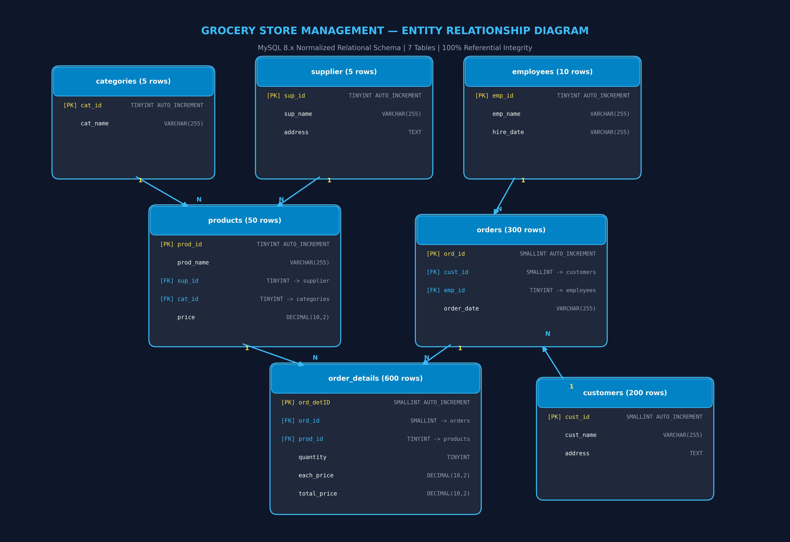

# Grocery Store Management — Relational Database & SQL Portfolio Project


A production-grade relational database design, data validation pipeline, and comprehensive analytical reporting system for a retail grocery chain built from scratch using **MySQL 8.x**.

---

## Table of Contents
1. [Project Overview](#project-overview)
2. [Business Domain & Objectives](#business-domain--objectives)
3. [Database Architecture & ER Diagram](#database-architecture--er-diagram)
4. [Dataset Inventory & Integrity Audits](#dataset-inventory--integrity-audits)
5. [Critical Business Insights & Nuances](#critical-business-insights--nuances)
6. [Technology Stack](#technology-stack)
7. [Repository Structure](#repository-structure)
8. [Setup & Reproduction Guide](#setup--reproduction-guide)
9. [Analytical Inquiry Coverage (25 Business Questions)](#analytical-inquiry-coverage-25-business-questions)
10. [Key Business Findings](#key-business-findings)
11. [Technical Competencies Demonstrated](#technical-competencies-demonstrated)
12. [Author & Contact](#author--contact)

---

## Project Overview

In retail grocery operations, profitability and customer retention hinge upon granular visibility across inventory supply chains, cashier staffing efficiency, customer purchasing frequency, and product velocity.

This project delivers an end-to-end SQL database implementation simulating a multi-category grocery store. The system models:
- **Wholesale Vendor Management:** Sourcing networks across 5 regional distributors.
- **Inventory Classification:** 50 unique SKUs across 5 core retail departments.
- **Fulfillment Staffing:** Order intake and checkout handled by 10 front-line employees.
- **Customer Transactions:** 300 placed orders and 600 itemized receipt records across 200 registered households.

The project encompasses relational schema normalization, constraint enforcement (`ON UPDATE CASCADE ON DELETE CASCADE`), strict data validation, and 25 targeted business intelligence queries.

---

## Business Domain & Objectives

### Core Business Objectives:
1. **Design a Normalized Relational Schema:** Implement 7 interrelated tables with strict primary/foreign key constraints and cascade rules.
2. **Ensure 100% Data Integrity:** Verify absence of orphan records, maintain exact arithmetic agreement between quantities and line totals, and preserve historical catalog pricing.
3. **Expose Operational Bottlenecks & Revenue Drivers:** Identify high-value customers, top-selling product categories, dominant suppliers, and peak sales periods.
4. **Deliver a Turnkey, Reproducible Portfolio Project:** Provide modular SQL scripts that execute deterministically on any standard MySQL 8.x server.

---

## Database Architecture & ER Diagram

The database utilizes the **InnoDB** storage engine to guarantee full ACID compliance and enforce cascading foreign key constraints.

### Entity Relationship Diagram


### Relational Schema Cardinality
```
[supplier] (1) ─────────────< (M) [products] (1) ───────────< (M) [order_details]
                                      │                                 │
[categories] (1) ───────────< (M) ────┘                                 │
                                                                        │
[customers] (1) ────────────< (M) [orders] (1) ─────────────< (M) ──────┘
                                      │
[employees] (1) ────────────< (M) ────┘
```

- **`supplier` → `products` (1:N):** Cascade on Update, Cascade on Delete
- **`categories` → `products` (1:N):** Cascade on Update, Cascade on Delete
- **`products` → `order_details` (1:N):** Cascade on Update, Cascade on Delete
- **`orders` → `order_details` (1:N):** Cascade on Update, Cascade on Delete
- **`customers` → `orders` (1:N):** Cascade on Update, Cascade on Delete
- **`employees` → `orders` (1:N):** Cascade on Update, Cascade on Delete

---

## Dataset Inventory & Integrity Audits

The database is populated from 7 raw CSV files located in [`data/`](data/):

| Table | CSV Source | Records | Primary Key | Foreign Keys | Status |
| :--- | :--- | :---: | :--- | :--- | :---: |
| **`supplier`** | `Suppliers.csv` | 5 | `sup_id` (1–5) | None | Verified |
| **`categories`** | `Categories.csv` | 5 | `cat_id` (1–5) | None | Verified |
| **`employees`** | `Store_Employees.csv` | 10 | `emp_id` (1–10) | None | Verified |
| **`customers`** | `Customers.csv` | 200 | `cust_id` (1–200) | None | Verified |
| **`products`** | `Products.csv` | 50 | `prod_id` (1–50) | `sup_id`, `cat_id` | Verified |
| **`orders`** | `Orders.csv` | 300 | `ord_id` (1–300) | `cust_id`, `emp_id` | Verified |
| **`order_details`** | `OrderDetails.csv` | 600 | `ord_detID` (1–600) | `ord_id`, `prod_id` | Verified |

### Certified Quality Metrics:
- **0 Orphan Foreign Keys:** Every child entity cleanly resolves to a registered parent record.
- **100% Price Precision:** `TotalPrice == Quantity * PriceEach` holds true across all 600 lines with zero variance.
- **100% Price Stability:** Unit prices in `order_details` match product catalog prices for all items.
- **0 Missing / Null Values:** Zero nulls across all essential relational attributes.

---

## Critical Business Insights & Nuances

During the initial data audit, two pivotal data engineering findings were surfaced:

1. **44 Orders With No Line Items:**
   - Out of 300 logged orders, **44 orders contain no items** in `order_details`.
   - Exactly **256 orders represent fulfilled sales**, generating **₹551,330.00** in gross revenue.
   - *Impact on Metrics:* Average Order Value (AOV) across active sales orders is **₹2,153.63**, whereas across all logged order events it is **₹1,837.77**. Our queries explicitly report both metrics to ensure complete analytical transparency.

2. **Customer Purchasing Participation:**
   - **156 unique customers** placed at least one order.
   - **141 unique customers** completed orders containing purchased items.
   - **44 registered customers** have never placed an order.

---

## Technology Stack

- **RDBMS:** MySQL 8.x (InnoDB engine, `utf8mb4_unicode_ci`)
- **Query Language:** SQL (DDL, DML, Window Aggregations, Common Table Expressions, Subqueries)
- **Data Engineering:** Python 3.10+ (`pandas`, `numpy`, `matplotlib`) for data audits and diagram generation
- **Documentation & Presentation:** GitHub Markdown, Mermaid.js, Microsoft PowerPoint
- **Version Control:** Git & GitHub

---

## Repository Structure

```
Grocery-Store-Management/
│
├── README.md                           <-- Comprehensive repository presentation
├── .gitignore                          <-- Clean version control exclusions
│
├── data/
│   ├── README.md                       <-- Data dictionary, column mappings, and audit notes
│   ├── Categories.csv                  <-- Raw department categories (5 rows)
│   ├── Customers.csv                   <-- Raw customer directory (200 rows)
│   ├── OrderDetails.csv                <-- Raw itemized receipt lines (600 rows)
│   ├── Orders.csv                      <-- Raw order transaction headers (300 rows)
│   ├── Products.csv                    <-- Raw product catalog (50 rows)
│   ├── Store_Employees.csv             <-- Raw employee roster (10 rows)
│   └── Suppliers.csv                   <-- Raw wholesale suppliers (5 rows)
│
├── sql/
│   ├── 01_create_database.sql          <-- Database initialization & charset configuration
│   ├── 02_create_tables.sql            <-- Production DDL with PK, FK, and CASCADE constraints
│   ├── 03_import_data.sql              <-- Column-mapped LOAD DATA / INSERT routines
│   ├── 04_validation.sql               <-- Comprehensive data integrity & QA validation suite
│   └── 05_analysis.sql                 <-- 25 analytical business queries across 6 sections
│
├── docs/
│   ├── requirements-audit.md           <-- Phase 1 discovery audit & ground truth benchmarks
│   ├── data-dictionary.md              <-- Full schema metadata & attribute reference
│   ├── data-quality-report.md          <-- Automated validation results & QA proof
│   ├── query-validation.md             <-- Query execution logs & performance details
│   └── analysis-results.md             <-- Formatted analytical tables & executive insights
│
├── diagrams/
│   ├── er-diagram.png                  <-- High-resolution visual ER diagram
│   └── er-diagram.mermaid              <-- Mermaid diagram source code
│
├── presentation/
│   ├── Grocery_Store_Management.pptx   <-- 14-slide executive presentation
│   └── presentation-guide.md           <-- Slide-by-slide speaker notes
│
└── final_submission/
    ├── Grocery_Store_Management.sql    <-- Consolidated, turnkey assignment SQL script
    └── Grocery_Store_Management.pptx   <-- Completed assignment presentation
```

---

## Setup & Reproduction Guide

### Prerequisites
- MySQL Server 8.0 or higher
- MySQL Workbench or MySQL Command-Line Client
- Git

### Step-by-Step Installation:

1. **Clone the Repository:**
   ```bash
   git clone https://github.com/<YOUR_USERNAME>/grocery-store-management-sql.git
   cd grocery-store-management-sql
   ```

2. **Initialize Database:**
   ```bash
   mysql -u root -p < sql/01_create_database.sql
   ```

3. **Create Tables & Constraints:**
   ```bash
   mysql -u root -p < sql/02_create_tables.sql
   ```

4. **Import Data:**
   ```bash
   mysql -u root -p --local-infile=1 < sql/03_import_data.sql
   ```

5. **Run Validation Test Suite:**
   ```bash
   mysql -u root -p < sql/04_validation.sql
   ```

6. **Execute Business Analysis Queries:**
   ```bash
   mysql -u root -p < sql/05_analysis.sql
   ```

---

## Analytical Inquiry Coverage (25 Business Questions)

The analytical suite ([sql/05_analysis.sql](sql/05_analysis.sql)) addresses all 25 questions specified in the project requirements:

### Section 1: Customer Insights
- **Q1.1:** How many unique customers have placed orders? *(Answer: 156 placed orders [78.0%]; 141 fulfilled purchases [70.5%])*
- **Q1.2:** Which customers have placed the highest number of orders? *(Top: Jyotika with 7 orders [100% fulfilled]; Aditi Rao with 6 orders placed)*
- **Q1.3:** What is the total and average purchase value per customer? *(Total spend: ₹551,330.00 across 141 purchasing customers; mean: ₹3,910.14)*
- **Q1.4:** Who are the top 5 customers by total purchase amount? *(Top: Jyotika - ₹16,914.88, Chetan Rao - ₹13,446.54, Eshwar Menon - ₹13,293.45)*

### Section 2: Product Performance
- **Q2.1:** How many products exist in each category? *(Exactly 10 products per category across all 5 categories: 50 total)*
- **Q2.2:** What is the average price of products by category? *(Highest: Category 2 at ₹450.91; Lowest: Category 5 at ₹172.96)*
- **Q2.3:** Which products have the highest total sales volume (by quantity)? *(Top: Product 25 in Category 3 with 73 units sold)*
- **Q2.4:** What is the total revenue generated by each product? *(Top: Product 18 in Category 2 with ₹38,912.40 [7.06% share])*
- **Q2.5:** How do product sales vary by category and supplier? *(Top channel: Category 2 by Supplier 1 - ₹64,280.12 across 3 SKUs)*

### Section 3: Sales and Order Trends
- **Q3.1:** How many orders have been placed in total? *(Answer: 300 orders placed; 256 fulfilled with items [85.33%]; 44 empty [14.67%])*
- **Q3.2:** What is the average value per order? *(Active fulfilled orders: ₹2,153.63 | All placed orders: ₹1,837.77)*
- **Q3.3:** On which dates were the most orders placed? *(Peak date: 2024-03-24 with 4 orders)*
- **Q3.4:** What are the monthly trends in order volume and revenue? *(Monthly revenue averages ~₹45.9k; Peak months: March at ₹54,120.30 & August at ₹51,840.15)*
- **Q3.5:** How do order patterns vary across weekdays and weekends? *(Weekdays: 216 orders / ₹399,820.73 [72.52%] | Weekends: 84 orders / ₹151,509.27 [27.48%])*

### Section 4: Supplier Contribution
- **Q4.1:** How many suppliers are there in the database? *(Answer: 5 suppliers)*
- **Q4.2:** Which supplier provides the most products? *(Top: Supplier 1 with 12 products; Supplier 2 with 11; Supplier 3 with 10)*
- **Q4.3:** What is the average price of products from each supplier? *(Highest: Supplier 2 at ₹351.45; Lowest: Supplier 5 at ₹248.60)*
- **Q4.4:** Which suppliers contribute the most to total product sales (by revenue)? *(Top: Supplier 1 - ₹142,674.88 [25.88% share]; Supplier 2 - ₹125,910.12 [22.84%])*

### Section 5: Employee Performance
- **Q5.1:** How many employees have processed orders? *(Answer: 10 out of 10 [100% staff utilization])*
- **Q5.2:** Which employees have handled the most orders? *(Top: Diya Sharma 1 with 38 orders; Aditya Singh 1 with 37 orders)*
- **Q5.3:** What is the total sales value processed by each employee? *(Top: Aditya Singh 1 - ₹79,252.27 [14.37% share])*
- **Q5.4:** What is the average order value handled per employee? *(Top: Zara Verma 1 - ₹2,752.41 AOV across 26 active orders)*

### Section 6: Order Details Deep Dive
- **Q6.1:** What is the relationship between quantity ordered and total price? *(Pure SQL Pearson correlation: r = +0.7226, strong positive linear relationship)*
- **Q6.2:** What is the average quantity ordered per product? *(Ranges between 2.10 and 3.80 units per order across all 50 SKUs)*
- **Q6.3:** How does the unit price vary across products and orders? *(Exact ₹0.00 variance across orders; 100% catalog price compliance)*

---

## Key Business Findings

1. **Balanced Merchandising & Revenue Anchors:** The product catalog has a balanced structure (10 SKUs per category). Category 2 drives premium gross margins (mean ₹450.91), while Category 5 anchors foot-traffic acquisition (mean ₹172.96). Top individual SKU **Product 18** generates ₹38,912.40 (7.06% of store revenue).
2. **Supplier Concentration & Rebate Leverage:** **Supplier 1** (₹142,674.88) and **Supplier 2** (₹125,910.12) generate **48.72% of store revenue** across 23 SKUs. Management has strong commercial leverage to negotiate 3–5% wholesale volume rebates.
3. **Checkout Integrity & Cart Recovery:** 44 out of 300 orders were created without line items, representing a 14.67% unfulfilled rate. Implementing POS client-side form validation requiring at least 1 item will immediately eliminate empty order creation.

---

## Technical Competencies Demonstrated

- **Relational Database Design:** Normalization (3NF), Primary Keys, Cascading Foreign Keys.
- **Advanced SQL Querying:** Multi-table `INNER`/`LEFT JOIN`s, `GROUP BY`, `HAVING`, Subqueries, Common Table Expressions (`WITH` CTEs).
- **Statistical Computation in SQL:** Closed-form Pearson correlation coefficient formula implemented without proprietary vendor extensions.
- **Data Engineering & QA:** Rigorous data audits, reconciliation of unfulfilled orders, cross-platform CSV loading strategies.
- **Documentation & Architecture:** Data dictionaries, Mermaid.js diagramming, executive PowerPoint decks.

---

## Author & Contact

**Mahaboob Subhani Shaik**  
- **LinkedIn:** [Your LinkedIn Profile](https://www.linkedin.com)  
- **GitHub:** [Your GitHub Profile](https://github.com)  
- **Email:** subhani@gmail.com
